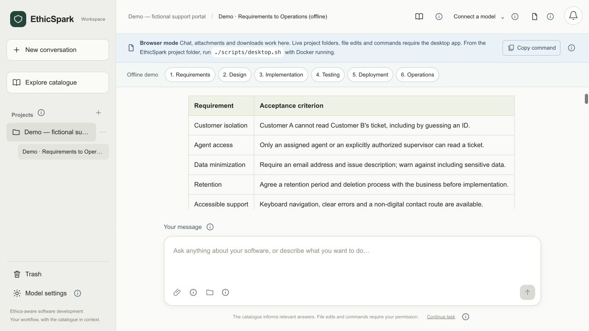
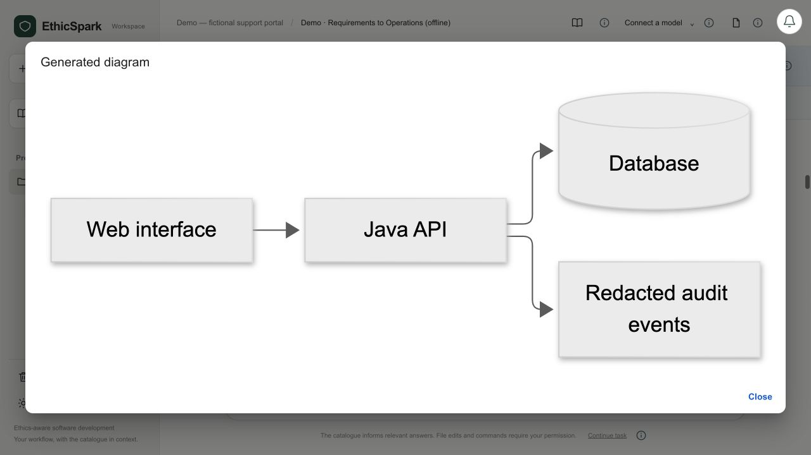
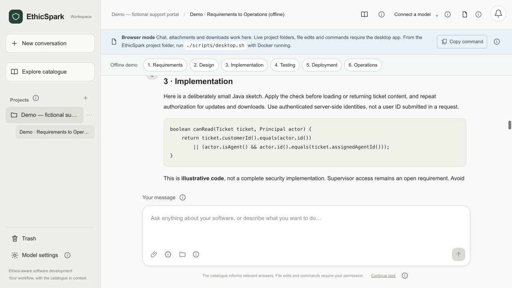
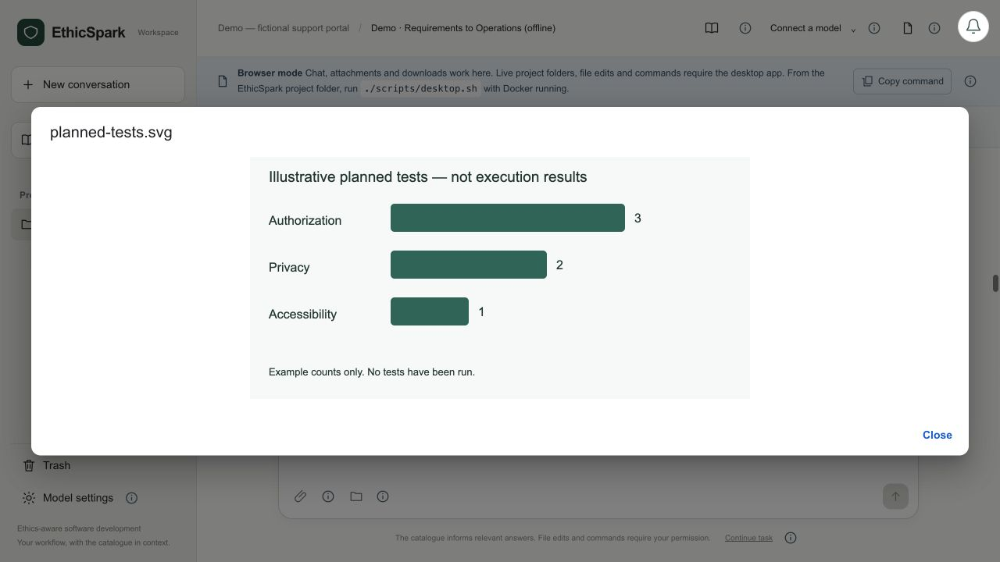
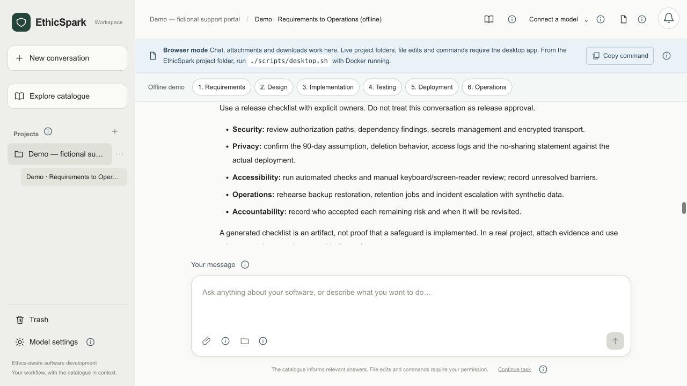
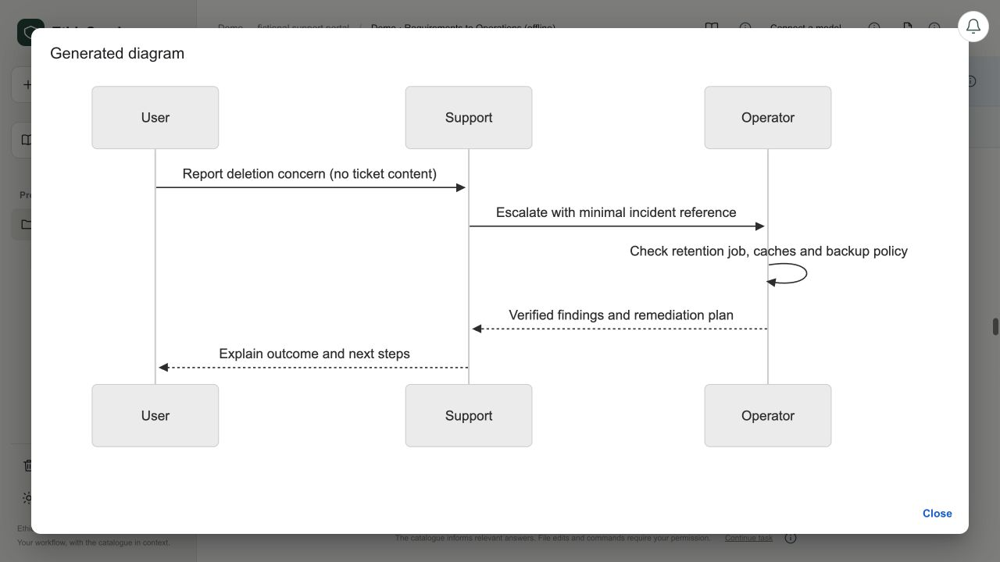

# Ethics-Aware Software Engineering Catalogue

EthicSpark is a standalone conversational workspace for software development, with an ethics-aware catalogue in context. Start from a prompt, documents or a live local project folder. The assistant helps with general engineering tasks and introduces ethical considerations when relevant; no profile questionnaire or upfront cluster choices are required.

Responses support Markdown, code, tables, Mermaid diagrams, SVG figures, self-contained raster images and downloadable artifacts. Visuals appear directly in the conversation and can be enlarged or downloaded. The desktop app can read current project files, propose changes and run commands/tests **only after the developer reviews and approves each operation**. Conversations and operation results persist in PostgreSQL.

The catalogue contains **24 clusters, 144 actions and 184 references**, using Know, Protect, Inform, Assess, Validate and Respond. The updated author workbook is included as a separately versioned public dataset, with research observations omitted. See [data provenance](docs/DATA_PROVENANCE.md).

You can also **Explore catalogue** without configuring a model. Browse source clusters, actions, ethics labels, phases, roles and all references in the browser or desktop app. The local backend must be running, but no API key or Ollama is required. Open the sidebar’s **Explore catalogue** button or visit [the standalone explorer](http://localhost:8082/?catalogue=1).

## Latest development update — 22 October 2026

- **Model settings → Provider → OpenAI-compatible** connects to official OpenAI or a third-party Chat Completions service using its own API base URL and optional API key. Save the connection, load or enter a model ID, then authorise project processing. Advanced options cover output token parameters and optional JSON mode. Official OpenAI configuration remains separate and unchanged. See [connection setup](docs/CONVERSATIONAL_WORKSPACE.md#openai-compatible-api-connections).

- **Model settings → Reset…** offers **Reset settings** for this browser/desktop app, and **Reset workspace** for the shared backend. Workspace reset restores the original offline demo after clearing user data, Trash and legacy workflow history, requires an unchanged reviewed summary plus typing `RESET`, and offers an archival JSON export first. The catalogue, host project files, Ollama installations and server credentials are kept. Native operations and running requests block reset; reopen the desktop app to load the updated bridge.

- **Model settings → Ollama → Reasoning level** offers **Automatic (compatible)**, **Model default** and the controls advertised by the selected model. Choices are remembered separately per model in each browser/desktop app. Unsupported preferences fall back to the model default without switching models.
- Automatic checks model capabilities; it does not benchmark CPU/RAM or infer the Ollama host's resources from Docker. Lower reasoning can reduce processing time where supported, but does not guarantee lower loading memory.
- Model-service notifications distinguish authentication (HTTP 401), access restrictions (403), request/usage limits (429) and incompatible request options. Credentials remain server-side.

## Explore the default demo

A new installation includes **Demo — fictional support portal**, a six-stage conversation from Requirements to Operations. It works without an API key or Ollama. If removed, restore it with **Projects (+) → Load demo project**. A complete workspace reset restores the original demonstration.

The screenshots below show the bundled, authored example in the browser workspace. They are illustrative guidance—not live model responses, executed tests, implemented safeguards or expert validation. The desktop app uses the same conversational interface and adds permission-controlled access to local folders, file edits and commands.

### Requirements

Agree the scope, access rules, data minimization, retention and accessibility criteria before implementation.



### Design

Inspect an enlarged architecture diagram showing the web interface, Java API, database and redacted audit events.



### Implementation

Review an illustrative Java authorization check, its limitations and a downloadable implementation checklist.



### Testing

Explore planned privacy, authorization and accessibility checks, with an illustrative chart and downloadable test-plan data.



### Deployment

Work through a release-review checklist covering security, privacy, accessibility, operations and accountability.



### Operations

Follow the response to a fictional deletion report: investigate, contain unintended access, correct the cause and communicate the verified outcome.



See the [usage guide](docs/CONVERSATIONAL_WORKSPACE.md), [changelog](CHANGELOG.md) and [validation evidence](docs/VALIDATION.md) for details and development history.

## Start the desktop app

Prerequisites: Docker Desktop (or Docker Engine with Compose v2), curl, and a graphical macOS/Linux session. The launcher downloads and verifies its pinned local Node runtime and installs the locked Electron dependency; no global Node/JDK/Maven setup is required to run the application.

```sh
./scripts/desktop.sh
```

For catalogue browsing, choose **Explore catalogue** immediately. For an AI conversation, open **Model settings** to choose OpenAI, OpenAI-compatible, Anthropic Claude or Ollama. Configure OpenAI/Claude keys in your ignored local `.env`, save a compatible API connection in Model settings, or start Ollama and install a model. Authorise the selected provider to process the current project's shared context. Model choice is remembered. You can then start with a single prompt; a folder and attachments are optional.

See [conversational workspace](docs/CONVERSATIONAL_WORKSPACE.md) for the complete journey, folder freshness, action previews, permissions and limitations. This is a source-distributed desktop MVP, not a signed self-contained installer. Host project commands still need the project's usual tools installed.

## Browser workspace

```sh
./scripts/run.sh
```

Open [localhost:8082](http://localhost:8082). Browser use supports chat, uploads and downloads. Direct live-folder access and native action execution are available in the desktop app. The local backend and database run in Docker; PostgreSQL is not exposed by the normal Compose deployment.

The script generates local database credentials in an ignored `.env` on first use. Existing data survives restarts. `docker compose stop` stops backend services without deleting the database.

The previous structured workflow remains at [localhost:8082/?legacy=1](http://localhost:8082/?legacy=1) for existing projects and approved plans. Historical data is retained.

## Use a local model without cloud API credentials

1. Install and start [Ollama](https://ollama.com/download). Download a local model compatible with your hardware; the tested `qwen3.8:27b` example ran on an Apple M4 Pro with 48 GiB memory.
2. Run `ollama list`. Use the exact **NAME** value, including its tag, as Model ID; the digest in the ID column is not the model name.
3. In **Model settings**, choose **Ollama**, press **Load available models**, select the installed model, authorise local processing for your project and press **Done**.
4. Send a prompt or attach relevant material. Keep Ollama and Docker running. Live folders, file changes and commands require the desktop app.

The first local response may take several minutes to load the model and evaluate the catalogue. Ollama defaults to a 600-second request timeout, 8,192 output tokens and low reasoning effort where supported. The optional `.env` settings are documented in [.env.example](.env.example) and [troubleshooting](docs/CONVERSATIONAL_WORKSPACE.md#ollama-troubleshooting). Existing error messages remain in history; **Retry with saved context** submits a new request.

## Manage projects

Use **⋯** beside a project to rename it, open its linked folder or move it to Trash. **Open folder** requires a linked folder in the desktop app; the browser explains the limitation. **Trash** at the bottom of the sidebar restores saved conversations and material. Deletion is reversible and does not permanently erase stored data or delete local files. Link the folder again after restoring a project.

## Inspect the catalogue

Read the version `id` from `GET /api/catalogue/versions`, then substitute it for `{version}` below. IDs include the complete SHA-256 digest and importer version.

| GET endpoint | Result |
| --- | --- |
| `/api/catalogue/versions` | Imported versions, counts and warning count |
| `/api/catalogue/versions/{version}` | Version metadata and import state |
| `/api/catalogue/versions/{version}/clusters?q=privacy` | Search by ID, title, definition and constituent concerns |
| `/api/catalogue/versions/{version}/clusters/C-01` | Full cluster, label mappings, actions and source references |
| `/api/catalogue/versions/{version}/actions?category=VALIDATE` | Actions filtered by category |
| `/api/catalogue/versions/{version}/actions?phase=Operations` | Actions applicable to a phase, including all-phase actions |
| `/api/catalogue/versions/{version}/actions/C01-A1` | One source action |
| `/api/catalogue/versions/{version}/references` | All 184 reference records |
| `/api/catalogue/versions/{version}/references/R-184` | One reference record |
| `/api/catalogue/versions/{version}/source-cells?locator=C01!C28` | Original cell text and type |
| `/api/catalogue/versions/{version}/report` | Validation errors, warnings and normalisation decisions |
| `/actuator/health/readiness` | Application and database readiness |

Missing versions or entities return HTTP 404. Invalid category parameters return HTTP 400 with an English problem detail. Catalogue APIs remain read-only; the project workflow uses the separate write endpoints described below. Import and catalogue publication have no HTTP write endpoints.

## Earlier structured workflow API

| Endpoint | Purpose |
| --- | --- |
| `GET /api/projects` | List locally stored projects |
| `POST /api/projects` | Create a project using the latest imported catalogue |
| `GET /api/projects/{id}` | Read the current profile, selection and recommendations |
| `PUT /api/projects/{id}/profile` | Save or confirm profile; confirmed versions are retained |
| `PUT /api/projects/{id}/selection` | Save manual selection across all clusters |
| `PUT /api/projects/{id}/recommendations/{action}` | Save an edit or record accept/reject/awaiting-information |
| `GET /api/projects/{id}/history` | Inspect immutable decision events |
| `GET /api/projects/{id}/draft` | Preview the current draft and its gaps |
| `GET, POST /api/projects/{id}/plans` | List approved versions or approve a snapshot |
| `GET /api/projects/{id}/plans/{plan}` | Inspect one approved snapshot |
| `GET /api/projects/{id}/export?format=html\|json&plan={plan}` | Export an approved snapshot; omit plan for a clearly labelled draft |

Mutations include the current `revision` and a self-reported `actor`. Stale revisions return 409. Approval also requires a UUID `requestKey`, reused for retries of the same request. A confirmed profile and at least one accepted selected recommendation are required. Profile changes reopen all recommendation reviews while preserving approved plans. Implementation remains Not started; evidence validation is a later increment.

## Import rules and provenance

The importer reads the actual XLSX workbook using Apache POI. The build includes the workbook as a read-only source for the non-root runtime user, avoiding host bind mounts and Docker Desktop file-sharing configuration. It does not depend on extracted intermediate JSON files. Header names and expected ID sets are validated. Formula/error cells, missing required data, duplicate IDs, unknown action categories and unresolved references block import and prevent persistence.

- Category aliases Verify and Validate map to `VALIDATE` in the category field only.
- Requirement/Requirements map to Requirements; Operation/Operations map to Operations, with surrounding whitespace/case ignored.
- All SDLC phases is stored as applicability scope, not a phase name.
- Other phase names are retained; unresolved mappings generate warnings rather than semantic guesses.
- Comma-only role lists in the updated workbook are parsed as separate roles. In mixed semicolon/comma lists, commas within role items are retained and flagged for review.
- Original nonempty catalogue and reference cells retain worksheet/cell locations, exact text and cell types. General interview notes are outside the catalogue entity model. The original workbook bytes are also retained in the database.
- The report flags incomplete and potentially truncated bibliographic metadata. No bibliographic corrections or source-support claims are invented.

The importer validates identifier relationships, not the substantive support of every recommendation by each publication. Draft source prose is retained as supplied, including occurrences of “verify” and “Verification”; the approved renaming applies to action-category labels.

Imported versions have state **IMPORTED**, not PUBLISHED. Existing ambiguities require review before a future publication workflow. The report is available from the API and in the reports volume:

```sh
docker compose cp application:/app/reports/import-report.json ./tmp/import-report.json
```

Create `tmp` first if it does not exist. On invalid input, startup fails after writing its report; inspect container logs and the report. A malformed/unreadable workbook fails before structured validation and is reported in the startup error log.

## Build and test

```sh
./scripts/test.sh
```

This builds with Java 25, installs Node for the Maven-integrated frontend build, checks TypeScript and bundles React. The current Java suite has **48 tests** (13 importer, 9 gateway, 1 provider-configuration unit test and 25 PostgreSQL integration cases). The production frontend build runs **13 helper tests**. The separate desktop suite has **13 native-agent tests**, run by CI and described in [validation](docs/VALIDATION.md). It runs importer regression tests and PostgreSQL integration tests covering catalogue integrity, manual review, stale edits, approval idempotency, immutable plans, profile reassessment and HTML/JSON export, including HTML escaping. It does not connect to the normal development database.

With a local JDK 25, use the Maven Wrapper:

```sh
./mvnw -B verify
```

This runs unit tests and packages the application; PostgreSQL integration tests require `-Pintegration` and `DB_URL`, `DB_USER`, `DB_PASSWORD` pointing to a dedicated test database. Flyway creates the schema there.

To run the service with a host JDK, start only the development database:

```sh
docker compose -f compose.yaml -f compose.dev.yaml up -d database
./mvnw -B package
DB_PASSWORD=your-local-password java -jar catalogue-service/target/catalogue-service-0.1.0-SNAPSHOT.jar
```

Supply the password from your local `.env` without committing it. Host defaults use database port 5433 and application port 8082. `CATALOGUE_PATH` and `CATALOGUE_REPORT` can override source and report paths. Set `CATALOGUE_IMPORT_ENABLED=false` to serve already imported versions without reading a source workbook.

## Structure and next increment

```text
catalogue-core/       Catalogue model, XLSX importer and validation tests
catalogue-service/    Spring Boot, Flyway, catalogue and project workflow APIs
catalogue-web/        Conversational React/TypeScript workspace and legacy UI
desktop/              Electron window and permission-controlled native project agent
scripts/             One-command run and isolated test commands
docs/                MVP specification, architecture and operational notes
data/                Public catalogue dataset
MY-INPUT/            Local research inputs, excluded from Git and Docker
```

See [MVP specification](docs/MVP_SPECIFICATION.md), [architecture](docs/ARCHITECTURE.md), [validation results](docs/VALIDATION.md), [manual walkthrough](docs/MANUAL_WORKFLOW.md) and [backup and restore](docs/OPERATIONS.md). See [conversational workspace](docs/CONVERSATIONAL_WORKSPACE.md) for the primary journey and [the earlier assisted workflow](docs/ASSISTED_WORKFLOW.md) for historical form-based projects.

This is a local research prototype. Native commands run with user permissions, not inside an OS sandbox. Reviewer names are self-reported audit labels, not authenticated identities; all local projects are accessible to the local operator. Shared expert deployment, authentication, project permissions and catalogue publication review remain later increments. Cloud inference requires operator-configured API credentials and project/provider processing authorisation. Each native file edit or command separately requires one-use approval. Paper and handoff drafts, credentials, build products and temporary extraction files are excluded from Git.

## Coauthor collaboration and replication package

This public development baseline is available for inspection and local reproduction. See [replication package preparation](docs/REPLICATION_PACKAGE.md) for included artefacts, reproducibility steps, the relationship to the draft paper and decisions before public release. See [contributing](CONTRIBUTING.md) for review and change instructions. The final licence and citation metadata remain to be agreed with the coauthors; this baseline is not a complete paper replication package or an empirically evaluated tool release.
