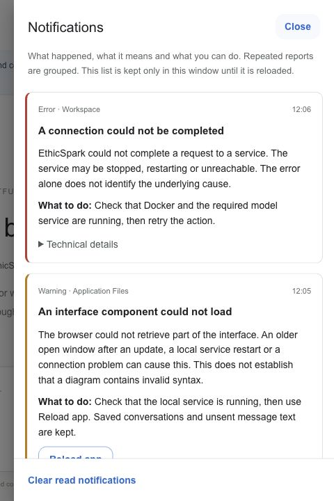

# EthicSpark conversational workspace

## Browse the catalogue without AI

Choose **Explore catalogue** in the sidebar, the book icon in the top bar, or **Explore catalogue without a model** on the welcome screen. The viewer opens over the workspace; **Close catalogue** returns to the current conversation and preserves the unsent message.

For direct access, start the backend with `./scripts/run.sh` and open `http://localhost:8082/?catalogue=1`. This page loads only the read-only catalogue APIs. It does not require a project, model, processing permission, API key or Ollama. Docker and the local backend remain necessary.

- **Clusters & actions:** search source content; optionally filter by action category, SDLC phase or ethics label. Actions marked for all phases remain included when filtering a phase. Select a cluster to read its definition, ethics-label characteristics, scope and source actions, including evidence, roles and source locations.
- **References:** browse all 184 records or follow a cluster/action’s linked references. Search by ID, title, author or year. Web source links open only when clicked; the desktop app opens them in the system browser.
- **Import notes:** inspect source-review warnings, normalisation notes and source provenance. Displayed source content is not generated or rewritten by an LLM.
- **One catalogue:** there is no version selector. **Copy catalogue link** produces a local URL for the selected cluster. Import identifiers and source hashes remain available under provenance for audit and replication; they are not user choices. Recipients need their own running backend; localhost is not a public hosted catalogue.

The primary interface is now a general software-development conversation. Start with a prompt, attach material, or link a local project folder. The catalogue supplies relevant ethical guidance alongside other engineering considerations. There is no required application profile, phase questionnaire or upfront cluster selection.

## Start the desktop app

Prerequisites: Docker Desktop / Docker Engine with Compose v2, curl and a graphical macOS or Linux session.

```sh
./scripts/desktop.sh
```

The launcher starts the Java/PostgreSQL backend, verifies and caches a pinned Node runtime locally, installs locked desktop dependencies, downloads the pinned official Electron binary and opens EthicSpark. Initial startup requires network access. No global Node, Maven or JDK installation is needed to run the app itself. Commands requested against a developer's own project still need that project's normal tools installed on the host.

This is a source-distributed desktop MVP, not a signed self-contained installer. Its native window is independent of Codex/ChatGPT and uses the local backend. The backend remains Dockerised; host file access is handled by the desktop process rather than a container mount or Docker socket. Close the native window to stop the desktop process; backend containers remain available until `docker compose stop`.

Browser-only use is available after `./scripts/run.sh` at http://localhost:8082. It supports conversations, attachments, catalogue context, diagrams and downloaded text artefacts. Direct live-folder access, approved file edits and command execution require the desktop app. The interface indicates this distinction.

## First conversation

1. Open Model settings, choose OpenAI, Anthropic Claude or Ollama, and load or enter an available model ID. Provider credentials are configured in the ignored local `.env`, as described in [provider setup](ASSISTED_WORKFLOW.md). Model choice is remembered.
2. Authorise processing of messages and shared material for the current project/provider. External provider wording covers shared file contents and approved command output. Do not paste credentials into a conversation.
3. Write your request. The first message can create a workspace automatically. Optionally create a named project and link a local folder using the native folder picker.
4. Attach files with the paperclip, drop files onto the composer, or choose project files in the context panel. The assistant can request other relative paths when needed. No SDLC or ethics selections are required first.
5. Review the answer and continue normally. Relevant catalogue citations open source cluster information. They are optional supporting context, not a mandatory checklist.

Examples: “Help me understand this repository”, “Investigate why these tests fail”, “Design an API for this feature”, or “Review the privacy implications of this workflow”. The assistant may ask a focused question when needed, but it should progress with the context already available.

## Offline lifecycle demonstration

Choose **+** beside Projects, then **Load demo project**. No provider configuration or processing consent is needed to load it. The bundled fictional support portal contains six question/answer pairs, from Requirements to Operations, with an architecture diagram, implementation sketch, planned-test chart and release/incident checklists. Fresh installations and complete resets include this original demo. During normal use, loading it again preserves subsequent conversation. Everything is labelled as an authored demonstration: no inference, file operations or tests are performed.

The endpoint `POST /api/assistant/projects/demo` (empty body) creates the example once and returns its conversation. Repeating it reopens the same project and thread. If the project is in Trash it is restored, retaining any additional conversations and edits. Renaming the project does not change its demo identity. A fresh database starts with the original demo after catalogue import. This one-time initialization does not restore a deliberately removed demo on ordinary restarts. Complete workspace reset explicitly recreates its original contents. To ask a live follow-up, configure a provider and explicitly authorise processing as for any other project.

## Visual artifacts in conversation

The assistant can return `text/vnd.mermaid` artifacts (`.mmd`/`.mermaid`), textual `image/svg+xml` artifacts, and self-contained PNG, JPEG, GIF or WebP images. Raster artifact content must be a complete `data:image/...;base64,...` URL; there is no binary image-generation service. Encoded content shares the existing 200,000-character artifact limit. Other formats remain downloadable with a text-source preview; arbitrary HTML is not executed.

Mermaid Markdown fences, SVG code fences and visual artifacts render in chat. Click an image to enlarge it in a dialog. Download saves the source/original image; Mermaid also offers a rendered SVG. SVGs are loaded in image context rather than inserted into the application DOM. Remote image URLs are not fetched automatically; refer to self-contained artifacts instead. Invalid image data produces a notice while the original remains downloadable.

Mermaid source is parsed before rendering. The known `graphTB`/`flowchartLR` missing-space pattern is corrected only at the start of the source; other syntax errors are not guessed away. A notice discloses a correction and source downloads retain the exact original. An incomplete diagram still fails gracefully. Parse/layout failures are explained in Notifications, the diagram card retains a discreet link and temporary rendering DOM is removed, including under repeated remounts. See the [Mermaid API documentation](https://mermaid.js.org/config/usage.html#syntax-validation-without-rendering).

## Folder access and freshness

The desktop app records the linked folder path locally in its Electron user-data directory. It does not copy the folder into PostgreSQL or Git. An OS watcher refreshes the file index; selected/read file contents are reread immediately before each model turn. If watching is unavailable, sending a message still rereads current context. The UI marks external changes and shows which files are included.

The initial model context contains a limited relative file index, not every file's contents. The assistant can request specific files, and the app may perform up to two automatic read/continuation rounds after the initial call. Linking a folder grants read context; it does not authorise edits or commands. The project/provider permission also governs sharing readable file contents with the selected model.

Context limits: 2,000 indexed files, traversal depth 12, at most 20 UTF-8 files / 200,000 bytes per file in a turn, and 500,000 characters of assembled model text context. Larger or binary files can be attached separately; attachment extraction and limitations remain visible. Text, PDF, DOCX, XLS/XLSX and PPTX text can be extracted; spreadsheet formulas are exposed as formula text and are not recalculated. Images require a vision model. Secret files, hidden configuration directories, dependency/build caches and symlinks are excluded from native reads/writes. The app does not infer that every nonexcluded file is safe for an external provider; the developer controls what project and material they share.

## Permission-controlled actions

The model returns proposals. The Java backend validates relative paths, source citations and operation structure; it has no host file-access or command-execution API.

For a file change:

1. Choose Review change. The native agent reads the actual file and checks the base SHA-256 supplied from prior context.
2. Inspect complete Before/After content in the app.
3. Request permission. A native OS dialog identifies the exact file and before/after hashes. Deny is the default.
4. After approval, the agent checks the file again and applies the change, preserving an existing file's mode. If it changed since preview, the edit is rejected. New files cannot overwrite files that appeared after preview.

For a command, the preview and native dialog show the executable, argument array, reason and working directory. Execution uses no implicit shell. Commands run with the developer's user permissions, can affect resources outside the folder and may use the network; this MVP is **not an OS command sandbox**. Review project scripts and arguments. Provider keys are not passed from the backend into the native child environment. Commands have a 120-second deadline, bounded output and a stop control; results report actual stdout/stderr and exit code. Nonzero exits are failures, not successful tests.

Each approval is one-use and applies to one exact operation. There is no automatic approval mode. Declined actions do not run. Applying one proposal does not grant permission for later actions. After a receipt, use Continue task to let the assistant consider actual results and propose the next step.

The native process uses scoped IPC, checks the sender/main-frame origin, disables Node integration in the renderer and enables context isolation and renderer sandboxing. The local backend serves a restrictive Content Security Policy. These measures and path/hash checks do not establish that arbitrary approved commands are safe or eliminate all filesystem race conditions. Authentication and multi-user authorisation remain outside this local deployment.

## Outputs and persistence

Conversations support Markdown, code blocks, tables, Mermaid diagrams and downloadable text artefacts such as Markdown reports, JSON, CSV and source files. Artefacts remain in the conversation and context panel. Downloads do not automatically write into a project. File changes use the separate approval flow.

The current app does not provide built-in live web search, audio transcription, image generation or arbitrary binary-document conversion. Unsupported input formats are retained as attachments with an extraction limitation, not claimed as understood. Images require a vision-capable provider/model.

PostgreSQL stores projects, threads, messages, generated proposals/documents, attachment snapshots and operation receipts. Native folder files stay on disk. File-context manifests record relative names and SHA-256; complete read contents enter the model request but are not separately stored in these manifests. Responses and approved command output may of course contain project content. Treat database backups and exports as project data.

Request keys prevent duplicate calls for identical submissions and reject reuse with different input. Only one response per conversation runs at a time. Stop marks a pending response cancelled; a later provider result cannot overwrite it. An already sent provider request may still finish and be billed. OpenAI/Anthropic requests use a 180-second provider timeout and a 16,000-token output limit. Ollama defaults to a 600-second timeout, 8,192 output tokens and low reasoning effort (where supported), configurable with `OLLAMA_TIMEOUT_SECONDS`, `OLLAMA_MAX_OUTPUT_TOKENS` and `OLLAMA_REASONING_EFFORT`. An empty effort value uses the model default. There is no silent model fallback. Timeout errors distinguish slow processing from connection failures. The last 40 completed conversation messages enter context, with an explicit omitted-history count.

## Catalogue and previous work

New projects bind to the latest imported catalogue. The model receives cluster definitions, label characteristics, all source action texts, evidence, phases and roles, plus a registry of reference IDs and its count. Repeated import coordinates, action concern lists and full bibliographic records are not sent with every conversation turn. Full references and provenance remain available in the source catalogue APIs. Catalogue citations are checked against that version. Other engineering advice is permitted and should be distinguished from catalogue-supported recommendations.

The updated author workbook is distributed through a separately versioned public dataset; see [data provenance](DATA_PROVENANCE.md). Importer v2 supports its comma-separated lists and preserves raw workbook evidence. Existing imported versions and approved structured-workflow plans are unchanged.

The earlier form-based interface remains at `/?legacy=1`, accessible from Model settings for historical projects. It is not the primary user journey.

## Verification

```sh
./scripts/test.sh
runtime_node=$(./scripts/node-runtime.sh)
PATH="$(dirname "$runtime_node"):$PATH" "$runtime_node" --test desktop/test/*.test.cjs
```

The Java suite uses real PostgreSQL and local HTTP provider stubs. Native-agent tests use disposable folders and simulated permission decisions; they exercise actual file writes and child processes. They do not automate the OS permission dialog or establish real-provider reasoning quality. No real project content is sent to a cloud provider by these tests. A live-provider and expert usability evaluation remain necessary.

Implementation references: [Electron security guidance](https://www.electronjs.org/docs/latest/tutorial/security), [native folder/dialog APIs](https://www.electronjs.org/docs/latest/api/dialog), and [Mermaid rendering/security](https://mermaid.js.org/config/usage.html).

## In-app explanations

Click the circled **i** beside a section, field or action that needs guidance to open its explanation. Familiar commands such as Close, Copy, Download and New conversation do not have additional information icons. Each explanation describes the purpose, expected next step and any relevant prerequisite or effect on shared context, files or model requests. These controls remain available beside disabled actions and do not perform the action they describe. Close explanation, Escape or clicking outside returns to the underlying view; keyboard focus returns to the information control.

The information icon in the top bar opens **How to use EthicSpark**, a short first-use guide available even in an existing conversation or on a narrow screen. Model connection, processing consent, live-folder access, generated downloads and operation approvals have separate explanations. The earlier structured workflow also includes page guides and explanations beside its actions and editable fields. All help text is in English.

## Manage projects

Open the **⋯** menu beside a project in the sidebar:

- **Rename project** changes its display name while retaining conversations, catalogue version and the linked folder. The earlier structured-workflow view uses the same new name.
- **Open folder** opens the project's linked local directory in Finder or the system file manager. It does not open a different folder picker or share additional context. It requires the desktop app and an existing folder link; the browser menu explains this limitation.
- **Delete project** asks for confirmation, then moves the project and its conversations to **Trash**. Saved material and immutable operation history are retained; this is not permanent data erasure. No local project file is deleted. The desktop folder link is cleared and future processing consent must be granted again.

Open **Trash** at the bottom of the sidebar to restore a project. Its saved messages, attachments, artifacts and receipts return. Link its local folder again if needed. Stop running responses or commands before deleting a project. This release does not provide permanent purge.

The opening mode banner states which environment is in use. Browser mode explains that live folders, file changes and commands need the desktop app, displays `./scripts/desktop.sh` and offers Copy command. Run it from the EthicSpark repository with Docker running. Desktop mode confirms native functionality and reminds the user that edits and commands need approval.

## Ollama troubleshooting

If model listing works but a response fails after several minutes, the connection may be healthy while the model is still evaluating the catalogue. The first response includes all 144 source actions and can take several minutes on a local model. The activity text explains this. Check Ollama's processing log and current model rather than reinstalling it. A timeout does not establish that the endpoint is unreachable.

The compact catalogue projection preserves the source text of every action and its evidence, phases and roles. It avoids sending full bibliography and repeated import metadata in every chat turn. Large attachments and long conversations can still exceed a model's practical context or performance limits; start a focused conversation when needed. Ollama requests now use its [native chat API](https://docs.ollama.com/api/chat), which exposes performance metrics and per-request model retention.

After a provider failure, **Retry with saved context** submits a new request using the saved conversation, including when the first response failed. Each retry is a new inference request. Earlier error messages remain in history.

## Choosing an Ollama reasoning level

In **Model settings**, select Ollama and a model, then use **Reasoning level**:

- **Automatic (compatible)** applies the server's `OLLAMA_REASONING_EFFORT` only when compatible with the selected model. The default preference is `low`; otherwise Ollama's model default applies.
- **Model default** omits `think` regardless of the server preference.
- Other entries are the selected model's advertised controls, such as Low/Medium/High or On/Off. A manual choice overrides the server preference. If the choice becomes unsupported, the request uses model default without switching models or making an extra inference request.

Preferences are remembered separately for each model ID in the current browser/desktop app. The capability check sends only the model ID to Ollama's `/api/show`; it does not send project material or run inference. Older Ollama metadata that advertises thinking without named levels exposes On/Off. No adjustable controls are invented for other models.

Automatic is a compatibility choice, not hardware tuning. CPU/RAM and model size alone do not determine supported reasoning levels; a Docker backend may see different resources from the Ollama host. Lower levels can shorten reasoning where supported, but model size, quantization and context are the main loading-memory constraints. The tool does not measure available host memory or guarantee that a selected model will fit.

## Model-service authentication and access errors

An **HTTP 401** notification means the provider rejected authentication. The installation operator should check the active server-side provider key (for example `OPENAI_API_KEY`), its organisation/project and applicable access or IP restrictions, then restart with `./scripts/run.sh` after changing the ignored `.env`. Do not paste credentials into a conversation. A ChatGPT account subscription does not configure a provider API key in this application.

HTTP 403 indicates denied access; HTTP 429 can indicate rate or credit/usage limits. The status alone does not identify the exact account-policy or billing cause. Provider response bodies and credentials are not echoed in these errors. Earlier failed responses remain in history; after correcting configuration, use **Retry with saved context** to make a new request.

## Ollama preparation and performance diagnostics

**Preload the selected Ollama model** is enabled by default in Model settings and can be disabled there. After an installed model ID is selected or restored, preparation sends only that ID to Ollama; it sends no project prompt, attachment, catalogue or file content. **Prepare model now** retries or refreshes preparation. While it runs, Model settings displays an animated circular gauge with elapsed time. The gauge is indeterminate: Ollama does not expose a live loading percentage, so the app does not estimate one. Closing and reopening settings retains the elapsed time for that preparation. Completion or failure replaces the gauge with the actual result. Reduced-motion preferences stop the circular animation while the timer and status remain available. Simultaneous preparation requests for the same model and duration are coalesced on the backend. No model is downloaded automatically. Catalogue exploration remains independent and does not trigger model preparation.

Use **Keep model in memory after use** in Model settings: **5 minutes**, **30 minutes (default)**, **60 minutes**, or **Custom** (a whole number from 1–240). The preference is saved separately per model in this browser or desktop app and is included in preparation and every subsequent assistant request. Invalid custom values prevent preparation and message submission. Changing the duration with automatic preload disabled takes effect on the next preparation or message; it does not retroactively reset an existing idle timer.

API clients and the earlier structured workflow that omit a duration use `OLLAMA_KEEP_ALIVE_MINUTES`, default 30. Operators can change that fallback in the ignored local `.env` (integer 1–240), then run `./scripts/run.sh`. No model-weight or conversation files are removed by retention settings. Keeping an approximately 18 GB model resident consumes memory; another client, switching models or memory pressure may affect availability. Disabling preload stops future automatic preparation; it does not unload an already resident model. Preloading reduces potential cold-start delay, not prompt processing or generation time.

The configured `OLLAMA_BASE_URL` continues to accept a `/v1` suffix. The backend removes that suffix to reach `/api/generate`, `/api/chat` and `/api/show`; reverse proxies must expose those native endpoints too. Existing cloud OpenAI and Anthropic transports remain unchanged. Images use Ollama’s native base64 message field; source catalogue content, JSON response validation and per-operation approvals are retained.

`OLLAMA_REASONING_EFFORT` uses an advertised thinking level when `/api/show` supplies supported values. An unsupported configured level is omitted, so Ollama uses the selected model’s default. Older models that advertise thinking but only provide a boolean switch receive `true` for a nonempty effort; `none`/`false` disables thinking. Models without thinking omit the control. An empty setting keeps the model default.

After a completed answer, expand **Response timing** to inspect backend context preparation, model-request wall time, and Ollama-reported model loading, prompt processing, generation, input/output token counts and generation rate. Missing values remain **Not reported**. The earlier preload duration is shown separately in settings and is not included in the answer’s loading duration. Transport/scheduling overhead means wall time need not equal the sum of the other fields. Timing records persist with the response; older messages are not backfilled. During a request, the interface displays a combined context/generation waiting state, not inferred real-time subphase progress. No speedup or quality improvement is guaranteed.

**Unload model now** releases the selected model from the shared Ollama server’s memory without deleting its installation or saved conversations. The button is disabled while this window prepares or awaits a response. Server checks also reject unloading a model with pending assistant messages or an active gateway generation/preparation. Other applications using the same Ollama server are outside these activity checks. After successful manual unloading, automatic preparation pauses for that model in this session until **Prepare model now** or a new message; reopening the app restores automatic preparation if enabled. Another client can load the model again.

The optional assistant message field is `keepAliveMinutes`; preparation accepts `{ "model": "installed-model-id", "keepAliveMinutes": 15 }` at `/api/reasoning/providers/ollama/prepare`. Manual unloading accepts `{ "model": "installed-model-id" }` at `/api/reasoning/providers/ollama/unload`. Unloading returns a conflict while a matching assistant message is pending or the gateway is preparing/generating with that model.

## Model list and clean installations — 17 October 2026

**Load available models** opens a complete, unfiltered dropdown for the selected provider. Choose the model explicitly; loading the list does not automatically select or preload its first entry. Saved available selections are retained. **Enter model ID manually** remains an alternative for exact IDs. Loading a list sends no project context and downloads no model.

A new Docker database contains only the original offline demo, with no author test history. The bundled [fictional example](../examples/fictional-support-portal.md) and welcome button **Try a fictional example** supply a safe starting prompt; selecting it only fills the composer. Model processing requires a separate explicit send and permission. Author test projects are not Git data. Existing Docker volumes are preserved on update. Delete project moves local projects into recoverable Trash and does not delete linked folders.

## Updating an open browser or desktop window

After the first installation of update detection, refresh an already-open window once (or restart the desktop app). Future entry-document changes are checked at startup and when the window regains focus or becomes visible. A detected deployment adds **Application updated** to the upper-right Notifications center, with **Reload app**. The app never reloads itself automatically.

A missing JavaScript/CSS component adds an application-file warning to Notifications rather than a Mermaid syntax message in the conversation. If the current entry document confirms a newer build, it becomes the update notice; if the service is temporarily unreachable or the current build is unchanged, the warning asks you to check the local service and reload. There is no automatic retry/reload loop. The entry document is served with `Cache-Control: no-store`.

**Reload app** keeps saved conversations in the database and temporarily saves the unsent message text in this window's session storage. It refuses to interrupt an active response or native command. Pending attachment selection is not restored by this text-draft mechanism; already uploaded files remain stored with their project. A catalogue component failure is contained inside its dialog so the workspace and draft stay mounted. This mechanism cannot repair a window still running code from before update detection was introduced: refresh that window once manually.

### Desktop interface differs from the browser

Use `./scripts/desktop.sh` from this checkout. The launcher prints its project directory and uses the application port actually published by Compose, including a customized APP_PORT. An explicit ETHICSPARK_URL overrides that address; the desktop log identifies whether it opens the workspace, the legacy workflow or the catalogue explorer. Do not set `?legacy=1` when expecting the conversational workspace.

On a fresh desktop process, only the HTTP interface cache is cleared before navigation. Local storage, provider/model preferences, linked-folder configuration and database conversations are preserved. The terminal reports the loaded entry asset and its HTTP status, allowing comparison with the browser entry document. Relaunching while an instance is already running focuses that window and requests the existing update check; it does not silently reload unsent work. A process running older native code still needs a complete quit and restart once.

## Notifications without interrupting the conversation

Open the bell in the upper-right corner, or press **Alt+N**, to read runtime warnings, errors and information. An unread dot is red when an unread error exists, amber for warnings and blue for information. Nothing opens automatically. Reading the panel acknowledges the current items; another occurrence makes the grouped report unread again. Clear read notifications removes acknowledged items from this window's list. History is limited to 50 grouped items, is not sent to a model and is not persisted across reloads.

Each item explains what happened, possible causes and a concrete next step. Technical details are optional and expandable. Missing interface modules are distinguished from Mermaid syntax failures, model-service requests, connection failures and input validation. Explanations do not automatically blame an external service or claim that EthicSpark cannot be responsible when the cause is unknown. A diagram or image with no preview retains a small link to Notifications and its source/download controls. Saved failed model responses retain their retry control with details in Notifications.

Workspace action errors, model preparation failures, source-catalogue loading failures and application-update notices use this center. Relevant field validation, catalogue-source import notes and the explicit permission explanations in native operation review remain in their own context; they are not hidden. The update notification's Reload app action keeps the existing draft-preservation and active-work checks.



Illustrative notification panel from synthetic connection and module-loading failures; this is not model output or empirical evaluation evidence.


## Reset settings or workspace

Open **Model settings → Reset…**. The dialog distinguishes two scopes:

- **Reset settings** restores OpenAI with no selected model, clears per-project processing consents in this client, restores automatic compatible reasoning, enables preload and restores 30-minute per-model retention. Projects, conversations, attachments, unsent text and folder links are preserved. An already loaded model is not unloaded. Server `.env` values and credentials are kept.
- **Reset workspace** permanently clears all projects, including Trash and the previous structured workflow, threads, messages, uploaded files, generated artifacts, operation receipts, profile/review/plan history and saved demo identity. The catalogue and import provenance are retained. The client clears its EthicSpark preferences/draft/context selections and, in the updated desktop app, unlinks all folders and invalidates approval tickets without changing their files. The original offline demo is recreated in the same reset transaction, with its six stages and 12 messages. Extra conversations or edits in the old demo are removed. This matches a fresh installation.

The complete reset displays counts, offers **Export workspace (JSON)**, and requires typing `RESET`. The backend compares the reviewed snapshot against current data; changed data requires **Refresh summary** and a new confirmation. The export contains database workspace records and uploaded attachment bytes encoded as base64, including Trash and legacy records. It excludes server configuration and live folder files; user content or command output may itself contain sensitive data. This is an archival export, not an automatic restore/import facility. Finish the download before deleting data you need to retain.

Both actions are blocked in the current interface during responses, uploads, preparation, model-list requests and native operations, and consult backend activity before proceeding. Complete reset additionally rejects active API mutations, pending responses and native-operation leases on the shared service. Approval/command leases are renewed every 15 seconds and expire after three minutes if the client disappears. The native bridge rechecks the lease after the permission dialog before making changes; commands retain their 120-second deadline. Reset is intended for a single local service instance; the activity registry is process-local and is not a distributed coordinator. Close older desktop instances and restart with `./scripts/desktop.sh` before using this increment.

The backend is shared by browser and desktop: a workspace reset affects both. Other clients retain their own preferences and local folder-link stores; reload them afterward. Deleted project identities cannot acquire new operation leases. Reset does not uninstall Ollama models, alter local project files, remove `.env` or revoke credentials at a provider. This local MVP has no multi-user administration/authentication boundary; do not expose its service as a shared public server.


## OpenAI-compatible API connections

For a service implementing the [OpenAI Chat Completions format](https://developers.openai.com/api/reference/resources/chat/subresources/completions/methods/create), select **OpenAI-compatible** in **Model settings**:

1. Enter the provider's **API base URL**, including its path/version prefix (for example `https://provider.example/v1`). Do not include `/chat/completions`, `/models`, credentials in the URL, query parameters or fragments. The tool appends the endpoint paths without adding another `/v1`.
2. Enter the provider's API key, if required. Arbitrary key formats are accepted; there is no OpenAI-prefix check. A service requiring no authentication can use the URL alone. If entering a key alone, the URL defaults to `https://api.openai.com/v1`; a third-party key normally needs that provider's URL too.
3. Click **Save connection**. Saving contacts only the local backend. It does not run inference or test the remote provider. The connection is shared by all windows of this installation.
4. Click **Load available models**, or **Enter model ID manually** if the provider does not implement `GET /models`. All returned IDs are shown without an OpenAI-name filter. Choose a model supporting chat and the required context/output formats.
5. Authorise this connection to process the project's shared material, then send your request.

**Advanced compatibility options** defaults to `max_tokens=4096` and no `response_format`. Choose `max_completion_tokens`, change the output limit (512–16000), or omit the token parameter if required by your service. Enable JSON mode only if it accepts `response_format: {"type":"json_object"}`. The system prompt and output validation always require EthicSpark's JSON schema, even without JSON mode. Text-only requests use ordinary string content; images use OpenAI image URL content blocks and require vision support. No compatibility retry silently resubmits or switches providers. OpenAI-compatible does not mean every model/service supports the catalogue context, images or structured replies.

Official **OpenAI** remains a separate provider using the existing `OPENAI_API_KEY`, `OPENAI_BASE_URL`, model filtering and request format. Existing OpenAI, Claude and Ollama configurations continue to work. The compatible connection also works with official OpenAI when supplied its URL and a valid key, using whatever token options that model supports. APIs requiring different authentication headers, arbitrary query parameters or non-Chat-Completions schemas are outside this adapter.

Keys typed into the settings form are sent to the local backend on Save and cleared from the form afterward. They are never placed in browser local storage or returned by the settings API. The backend stores the saved connection in `provider-config/openai-compatible.json`, with a private directory and owner-only file permissions in the Docker deployment. A named Docker volume preserves it across rebuilds. This is server configuration, excluded from Git, Docker build context, workspace exports and workspace reset. It is not an encrypted credential vault. Protect server access/backups. **Remove saved API key** clears just the key; **Forget connection** disables the saved custom connection. These actions do not revoke credentials at the provider.

An unchanged URL with a blank key field preserves the saved key. Changing the URL clears the old key unless a replacement is supplied, preventing accidental credential forwarding. Every save creates a new connection identity and requires fresh per-project processing permission. Stale requests are rejected before transmission; reopen settings to refresh the identity. An in-flight request retains its original endpoint and key snapshot. Keys are not included in model request bodies, provenance or provider error details. The request-provenance hash includes the custom endpoint and connection identity.

Optional `.env` defaults are `OPENAI_COMPATIBLE_BASE_URL`, `OPENAI_COMPATIBLE_API_KEY` and `OPENAI_COMPATIBLE_MODELS` (comma-separated model IDs). A saved UI configuration takes precedence, including an explicitly forgotten/disabled connection. `OPENAI_COMPATIBLE_CONFIG_PATH` selects the private file for non-Docker execution; Docker supplies its volume path. GUI saves need no restart; changed environment defaults require restarting the application. HTTP is accepted for local/self-hosted services and displayed with a transport warning. Use HTTPS for remote providers. In Docker, `localhost` means the application container: use `host.docker.internal` for a service on the host. The application remains a local single-user MVP, without multi-user administration or a public configuration API boundary.
