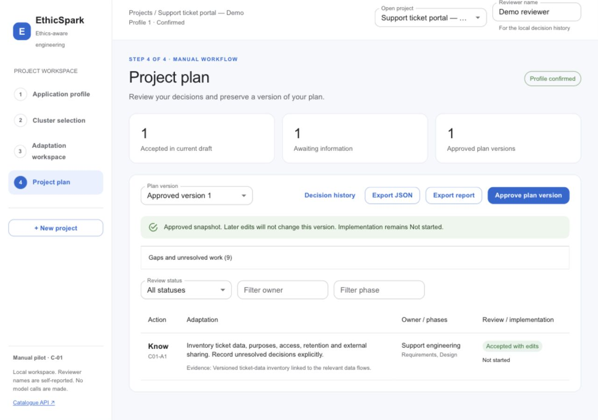
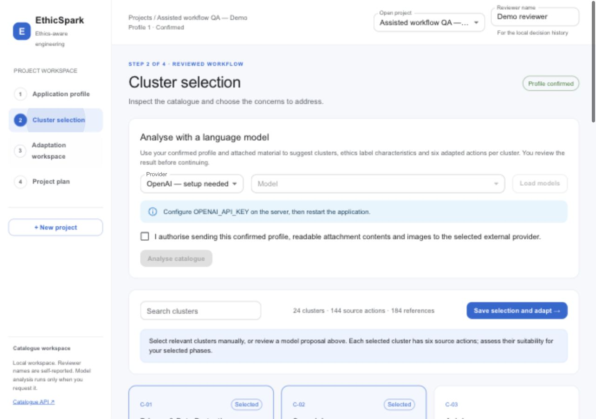
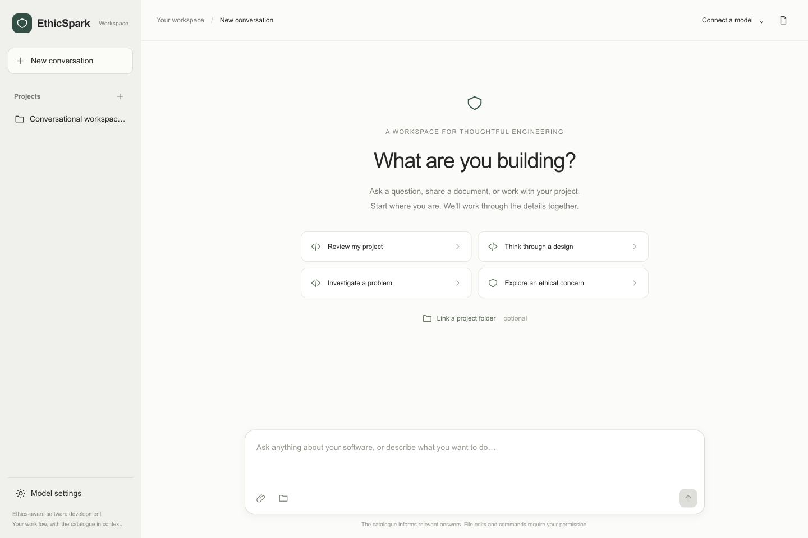
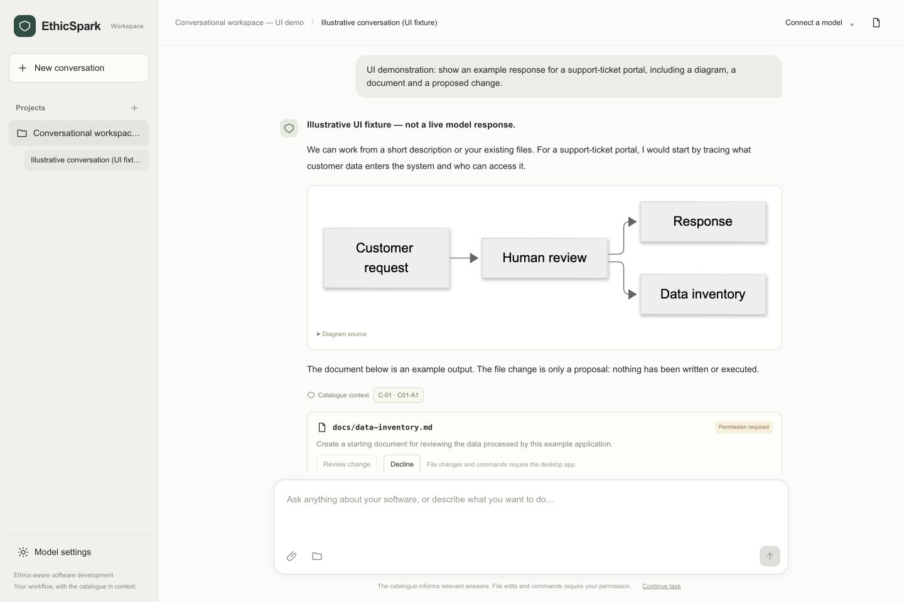

# Data foundation validation

Validation date: 14 October 2026.

The full authoritative workbook imported successfully with **24 clusters, 144 source actions and 184 references**. There were **zero blocking errors**. The complete machine-readable report is saved in [catalogue import report](validation/catalogue-import-report.json).

Source SHA-256: `ab5ea1ed529383de14e5456a7a42304274b0cb4b6718bbb0a3c3c1914ec30422`.

Importer version: `1`. Import state: `IMPORTED`. Warnings have been detected and retained, not automatically approved for publication.

## Source review findings

| Warning | Occurrences | Treatment |
| --- | --- | --- |
| Incomplete reference metadata | 96 | Missing author, year, authority or link fields remain missing |
| Possibly truncated reference title or link | 58 | Ellipsis-containing source text retained for review |
| Ambiguous comma within role list | 25 | Retained inside semicolon-delimited role items |
| Phase outside the initial recognised vocabulary | 24 | Original term retained; no unapproved semantic mapping |
| Missing cluster boundary notes | 1 | C03!F5 remains empty |
| **Total** | **204** | All warnings include source locations |

The report also records 23 informational normalisations: 17 phase delimiter decisions and six approved phase alias corrections. No source action-category alias was needed in the supplied rows: all 24 fifth actions already say Validate. Verify remains in the source's navigation text and some action prose; the importer does not replace arbitrary source sentences.

These counts are occurrences, not counts of distinct records or source defects. An ellipsis flag does not establish that a citation is invalid. Bibliographic correctness and substantive source support remain human review tasks.

## Automated and live checks

The Docker build runs Java 25 and Maven 3.9.11. The isolated integration stack uses PostgreSQL 17.6 with Flyway migration V1.

- Twelve importer tests passed, covering the complete workbook, C-01 source IDs and mappings, exact source text, approved aliases, missing/duplicate IDs, unknown references and categories, missing required data, changed headers, formulas, all-phase scope and ambiguous role/phase handling.
- One integration test passed against real PostgreSQL, exercising persistence and JSON round trips, original workbook retention, version-scoped APIs, expected error responses, idempotent imports, immutable records and foreign-key rejection. It also imports a second source revision with a repeated reference link, checks that provenance retains the repetition and confirms that the first snapshot remains unchanged.
- The normal Docker Compose stack started successfully and reached readiness.
- After restarting the application, the original single version remained present with counts 24/144/184.
- Live HTTP queries returned C-01 with six actions and eight label mappings, and the Validate category filter returned 24 actions.

Run `./scripts/test.sh` to repeat the isolated automated checks. The test database is separate from the normal application database. Intentional negative SQL checks produce database error log messages while their assertions pass.

## Manual workflow increment

The second increment adds React, TypeScript, Material UI and a Maven-integrated Vite build. Flyway V2 preserves projects, confirmed profiles, review events and approved plans in PostgreSQL. The automated suite now includes twelve importer tests and four integration tests, covering the catalogue foundation and three manual-workflow cases.

The workflow checks cover confirmation requirements, explicit unknown fields, stale revisions, C-01 scope, rejection reasons, save-versus-accept behaviour, immutable approval, retry idempotency, profile-change reassessment, matching JSON/HTML exports, HTML escaping and project-scoped plan lookup. The approval preview is checked against the actual approved content and gaps.

Browser QA exercises the support-ticket example through profile confirmation, C-01 selection, saving and accepting an edited Know action, deferring Protect and approving a plan with the remaining work disclosed. The approved view contains only the accepted action; pending actions remain in draft/history. Native downloads of both JSON and HTML were completed in the in-app browser and inspected: both contain approved version 1 with one included action, five exclusions and nine disclosed gaps. Desktop (1280 px) and narrow (500 px) layouts are inspected; the narrow document has no page-level horizontal overflow. The demonstration project is explicitly labelled Demo.

## Public dataset distribution

On 15 October 2026, a separate public workbook was prepared with participant observations omitted. See [data provenance](DATA_PROVENANCE.md). The historical source hash above identifies the original input used for the earlier checks. The bundled import report identifies the public input. The full 16-test Docker/PostgreSQL suite passed again with the public workbook, including assertions that expert-observation fields are empty.

## Scope

This validation covers the catalogue foundation and the local manual C-01 workflow, including the four screens. It does not establish empirical usability, model quality, regulatory compliance or ethical adequacy. The checks above describe the earlier manual baseline. The assisted increment is recorded below; shared-deployment access controls and implementation-evidence validation remain later increments. Reviewer names are self-reported, not authenticated identities.

## Profile material and assisted workflow increment

Implemented on 15 October 2026: optional attachments for every Known field; Company Ethics documents alongside known safeguards; optional Additional Material; explicit sharing None; multi-phase profile selection; all-cluster manual adaptation; OpenAI, Anthropic Claude and Ollama adapters; reviewed cluster/label proposals; six adapted actions per cluster with phase suitability; immutable reasoning/attachment provenance in PostgreSQL and plan exports. See [assisted workflow](ASSISTED_WORKFLOW.md).

The suite contains 12 importer tests, four original integration cases and five assisted integration cases. The added tests exercise real PostgreSQL and a local HTTP provider stub: all three wire formats, text/file-only profiles, additive company ethics, None, multipart uploads, cross-project attachment/run lookup, PDF/DOCX extraction, image payloads, unsupported/truncated material, immutable attachment records, all-six-action coverage, source label validation, phase validation, explicit human acceptance, multi-cluster plan export, missing authorisation, stale runs and provider errors without selection changes. No real cloud credentials or paid model calls are used in automated tests.

Live-provider output quality, prompt-injection robustness and expert usability remain unvalidated. Schema checks establish source membership and structural consistency, not ethical correctness or regulatory compliance. Existing catalogue-validation results must not be presented as tool validation.

The final local Docker/PostgreSQL run passed **21 tests** (12 importer and nine integration), with zero failures or errors. The production stack applied Flyway V3 and reached readiness while retaining existing projects and approved plans. Browser QA used a separate fictional Demo project: a company policy text file uploaded successfully; known safeguards text survived Company Ethics selection; None displayed the exact no-third-party-sharing statement; profile confirmation persisted the attachment; manual C-01/C-02 selection opened twelve correctly identified source actions. Provider selection showed all three adapters. Desktop (1280 px) and the default narrow viewport were inspected; the desktop document had no horizontal overflow. No real provider inference was attempted because cloud keys are not configured and Ollama is not running.

## Conversational desktop and refreshed catalogue

On 15 October 2026 the primary UI was replaced with a conversation-first workspace. No application-profile questionnaire, prior SDLC selection or cluster-selection gate is required. The earlier interface and immutable approved plans remain accessible separately.

The owner supplied an updated consolidated workbook. Its public derivative is `e51a3127bf1e667f5a9257b91cd5130adeaa0b2ea9915f677b685b22988a396f`; importer version 2 parses its comma lists and retains canonical phase/category terms. The fresh import has 24 clusters, 144 actions, 184 references, zero blocking errors and 179 warnings. Earlier sections describe historical input versions and checks.

The Java/PostgreSQL suite has 28 cases: 13 importer tests and 15 integration cases. Six new conversational cases cover prompt-only creation without profile confirmation, rich responses/documents, source citations, requested file context, pending operations without execution, immutable receipts, duplicate-request prevention, stale/different request keys, cancellation against a late provider, and rejected unsafe paths or invented citations. Seven native-agent tests use disposable folders and actual processes to verify current-file reads, excluded paths/symlinks, deny-before-write behaviour, single-use tickets, file hash/mode checks, new files, folder relinking, exact argv, nonzero exit codes and timeouts.

Browser QA used a clearly labelled local UI fixture (not a model-generated answer) to inspect Markdown, a rendered Mermaid graph, catalogue source inspection, a downloadable document and a proposed file change that remained unexecuted. The main entry screen was inspected without fields or prerequisite choices. A desktop-width document had no page-level horizontal overflow. The native Electron app was launched against the local Docker backend. Native-agent tests simulate permission choices; the actual OS confirmation dialog and a real cloud model inference were not automated.

This checks implementation behaviour, not expert usability, live-provider quality, complete prompt-injection robustness or equivalence to Codex's security model. Approved native commands run with user permissions; the MVP does not provide an OS command sandbox.

The final verification passed **28 Java/PostgreSQL tests and seven native-agent tests (35 total)**. Added Office attachment checks cover XLS/XLSX formula text without evaluation and PPTX slide text. Native checks also cover UTF-8 BOM round trips and force termination when a child ignores a graceful stop. Browser inspection at 1440 px and 500 px showed no page-level horizontal overflow; the generated Mermaid fixture rendered without browser errors, the artefact appeared in the context panel and C-01 opened the current source definition.

### Contextual explanations — 16 October 2026

Added English, click-to-open information dialogs beside conversational-workspace sections, actions and fields, including disabled actions. The earlier structured workflow has page guidance and action/field explanations. The top-bar information control opens the first-use guide.

Validation: Docker production build completed successfully (TypeScript checking and Vite build); local application returned healthy. Browser checks covered the first-use guide, disabled-operation help, model settings, a help dialog opened over the settings dialog, Escape dismissal with focus restored to the information control, and guidance in the earlier profile/cluster/adaptation/plan interface. The primary workspace had no horizontal overflow at 1440 and 390 CSS pixels, no nested button elements, and no captured browser errors/warnings. No model request or project-file operation was performed for these help checks. Screenshot: `screenshots/contextual-help-guide.png`.

### Project management and browser-mode guidance — 16 October 2026

The project menu supports rename, opening the linked folder in the desktop's system file manager, and confirmed soft deletion to Trash. Restore preserves conversation IDs, messages, attachments and immutable receipts. Migration V5 adds the trash marker; local project files are not removed. Familiar actions no longer show redundant information icons. Browser mode now explains the native-only features at entry and displays a copyable desktop launch command.

Validation: 30 Java/PostgreSQL tests passed (including rename consistency, trash/restore preservation and refusal to trash a project with a pending response), plus 8 native-agent tests. The folder-opening test checks the resolved linked directory and propagates file-manager errors through an injected opener; it does not automate Finder itself. Browser checks used a dedicated UI-check project to exercise creation, rename, trash and restore without model requests or local file changes. The UI-check project remains recoverable in local Trash. Browser inspection and production-build checks cover the menu, browser-only Open folder explanation, reduced information controls and mode banner. The banner screenshot is `screenshots/browser-mode-guidance.png`. No horizontal overflow was found at 384 or 1440 CSS pixels, and the browser reported no captured errors or warnings. Native bridge changes require reopening the desktop app.

### Ollama local inference timeout — 16 October 2026

Diagnosis on the local Apple M4 Pro / 48 GiB Mac: model listing succeeded through the Docker backend, but Ollama logged ~43,868–44,119 input tokens and termination at the previous 180-second deadline while still evaluating the prompt. This was slow processing rather than a disconnected endpoint.

The conversational catalogue projection now retains every cluster definition/label and all 144 action texts, evidence, phases and roles, while omitting repeated import metadata and full bibliographic records. The reference registry supplies all 184 IDs and the count; full bibliography remains in the versioned catalogue. A stable catalogue-first input prefix enables model-server prompt-cache reuse when available. Ollama defaults are separately configurable: 600-second request timeout, 8,192 output tokens, low reasoning effort. Cloud defaults remain unchanged. Timeout and malformed JSON errors have distinct messages.

Validation: 33 Java/PostgreSQL tests passed, including exact preservation of all action texts/evidence/phases/roles, reference counts, stable catalogue prefix, local generation settings and a simulated timeout returning 504. The previously completed 8 native-agent checks are unaffected. A real local `qwen3.8:27b` request (installed digest prefix `47951e4a6661`, MLX runner) using only the public catalogue and a fictional support-portal prompt completed in 233.6 seconds with 19,720 prompt tokens and five validated catalogue citations. No cloud provider, personal project file or native operation was involved. This single smoke check establishes transport/schema compatibility for that example, not general reasoning quality, expert validation or guaranteed latency. Cache speedup has not been benchmarked. The sample conversation remains in the local project “Ollama validation — synthetic example”. Screenshot: `screenshots/ollama-live-validation.png`.

The final regression run also verifies Retry with saved context after a conversation's first model failure, without requiring an earlier successful assistant output. It passed within the 33-test Java/PostgreSQL suite. The local backend was updated only after checking that no responses were pending.

## Independent catalogue explorer — 16 October 2026

The Docker production build passed TypeScript checking, frontend bundling and 15 Java unit tests (13 importer and two gateway tests). All nine native tests passed, including the new source-link URL validator. PostgreSQL integration tests were not repeated for this UI-only increment; the previous full-stack evidence remains documented above.

Browser checks exercised the standalone `/?catalogue=1` route and the workspace viewer with **Connect a model** displayed, without sending a model request. The standalone component reads only catalogue versions, cluster details, references and the import report; it does not mount the conversational workspace or invoke provider/model endpoints. Live checks confirmed:

- 24 clusters, 144 source actions and 184 references for importer v2, with 179 retained warnings.
- The Validate category reduces C-01 to its corresponding action; Operations reduces it to Respond. Ethics-label choices and filter reset work. A nonmatching search displays zero clusters.
- Action-linked references show three records for C01-A1; the complete reference registry can be searched to R-184. Import notes retain warning messages and source-cell locations.
- Selecting the 14 October snapshot switches to importer v1 and its 204 warnings.
- Closing the workspace viewer preserves a synthetic unsent message; no project or message was created by this check.
- At a 390-pixel viewport, document scroll width equals client width. Desktop layout and browser console were checked with no application errors recorded.

Native source links are restricted to absolute HTTP/HTTPS URLs without embedded credentials. Automated validation rejects file, JavaScript, data and relative targets, whitespace and oversized values. Opening a link through the installed Electron shell was not exercised in the browser check; an already-running desktop process needs reopening to load the new preload bridge.

## Ollama preparation and response timing — 16 October 2026

The final production frontend passed TypeScript checking and bundling. All **35 Java/PostgreSQL tests** passed: 13 importer tests, four gateway unit tests and 18 integration tests. Local HTTP stubs cover native Ollama JSON/image input, output and thinking controls, model retention, preparation without prompt content, rejection of unknown model IDs and invalid retention settings, duration/unit conversion, missing metrics and timeout reporting. The assistant integration test verifies persisted context/request timing and that unreported cloud loading time remains null. Existing provider, workflow, cancellation and approval tests remain passing.

A real native API smoke check with installed `qwen3.8:27b`, low thinking and a synthetic JSON-only prompt returned `done_reason=stop`: 51 input tokens, 45 generated tokens, 6.029 seconds reported loading, 0.680 seconds prompt processing, 1.870 seconds generation and 8.584 seconds total reported duration. This short prompt does not include the full catalogue and cannot be compared with the earlier 233.6-second support-portal check.

Browser testing confirmed that selecting the installed model prepares it without creating a conversation or sending project content. The preparation completed in 6.1 seconds, and the live Ollama process exposed the requested 30-minute expiry. The timed native API measurements are supplied by Ollama; the backend separately records model-request wall time and context preparation. No cold/warm comparative benchmark, sustained memory-pressure test or quality evaluation has been performed.

Two synthetic assistant turns then completed with the full catalogue and persisted metrics. Both were reopened successfully in the browser, with no recorded browser errors. Preload opt-out and restoration were checked; the original browser provider/project preferences and project processing permission were restored after verification. No file edits or commands were proposed or executed.

| Measurement | First assistant turn | Follow-up turn |
| --- | ---: | ---: |
| Backend context preparation | 0.047 s | 0.020 s |
| Model request wall time | 202.218 s | 42.269 s |
| Reported model loading | 0.0017 s | 0.0020 s |
| Reported prompt processing | 184.044 s | 39.207 s |
| Reported generation | 18.145 s | 3.036 s |
| Input tokens | 19,830 | 20,361 |
| Generated tokens | 403 | 70 |
| Generation rate | 22.21 tokens/s | 23.06 tokens/s |

The prompts and output lengths differ. These observations identify context processing as the dominant cost in this example; they do not isolate a preloading speedup or establish cache effectiveness across runs. The model was prepared before both turns. A later preparation following a browser reload completed below the UI’s 0.1-second display precision, and both existing timing panels remained available from the saved conversation.

## Per-model retention and manual unloading — 16 October 2026

All **37 Java/PostgreSQL tests** passed (13 importer, six gateway unit and 18 integration tests). Added transport tests verify per-request duration overrides on preparation and chat, reject durations outside 1–240, and confirm that unloading sends an empty request with `keep_alive=0`. A concurrent request test confirms that unloading returns HTTP 409 and sends no unload request while a generation holds the model’s activity lock. Existing requests that omit the new optional duration remain supported.

Browser checks confirmed the 5/30/60-minute presets, Custom and range validation: zero disables preparation, while 15 is accepted. Setting qwen to 60 minutes, switching to gemma and back retained separate 60/30-minute preferences without loading gemma. Real preparation of `qwen3.8:27b` with Custom 15 resulted in approximately 15 minutes remaining in Ollama’s process record. **Unload model now** removed qwen from `/api/ps` while preserving it in `/api/tags`. Re-enabling automatic preload after manual unload did not immediately reload it. No model files or conversations were deleted, and no generation was needed for these checks. Other clients using the same Ollama instance are outside the tool’s activity tracking.

Reloading the updated application restored Custom 15 from saved preferences and explicitly resumed enabled automatic preparation, as documented. The final frontend build passed TypeScript checks and Java unit tests after correcting an initial empty-selection status message. Browser console checks recorded no application errors. The verification ended with qwen’s 30-minute default restored in both preferences and Ollama; the original provider/model selections and preload setting were restored.

## Model preparation gauge — 16 October 2026

The production build passed TypeScript checking, frontend bundling and 19 Java unit tests. Backend behaviour is unchanged by this increment; the earlier 37-test integration result remains recorded above. Browser checks used a real cold load of `qwen3.8:27b`: an animated circular progress indicator and elapsed-time clock appeared, and successful completion replaced them with the actual result after 5.3 seconds. A second preparation remained visible across closing/reopening Model settings; the progress indicator had no `aria-valuenow`, matching its indeterminate semantics. Completion removed the indicator. An uninstalled synthetic model ID produced the existing explicit validation error and no lingering gauge. No model was downloaded and no project content or new message was sent. Original provider/model and preload preferences were restored afterward.

The native generate and running-model APIs expose no live loading percentage. The gauge communicates preparation activity and elapsed time, not measured fractional completion. Reduced-motion CSS disables the circular animation; the component clears its clock interval when removed.

## Single catalogue, complete model list and clean example — 17 October 2026

Production TypeScript checking, frontend bundling and 19 Java unit tests passed. Backend catalogue and workspace storage behaviour is unchanged; previous integration results remain recorded above. Live browser checks confirmed:

- The catalogue has no version selector and still exposes 24 clusters, 144 actions and 184 references. Copy catalogue link produced `/?catalogue=1&cluster=C-01`, with no version parameter. Closing the explorer preserved the unsent sample prompt.
- Load available models opened a dropdown containing both installed `gemma4:12b` and `qwen3.8:27b`. Reloading the list while qwen was selected continued to show both entries. Selection of gemma and optional manual ID entry worked. No model was automatically selected by loading the list.
- Try a fictional example filled the composer without sending a request or creating a thread. The restored local workspace has one active, explicitly illustrative project and one two-message offline conversation, with no attachments or execution receipts. Other author test projects were moved into recoverable Trash; this runtime cleanup is not a distributed seed or migration.
- Browser console checks recorded no application errors. Model/provider and preload preferences were restored, with no model inference or download used for this increment.

Repository inspection confirmed that startup imports only the public catalogue and does not seed author projects. Local database volumes, private inputs, credentials and generated outputs are not tracked. Fresh installations therefore contain no author conversation history. The bundled fictional prompt is available from the welcome screen and `examples/fictional-support-portal.md`; updating an existing installation retains its own Docker volume.
